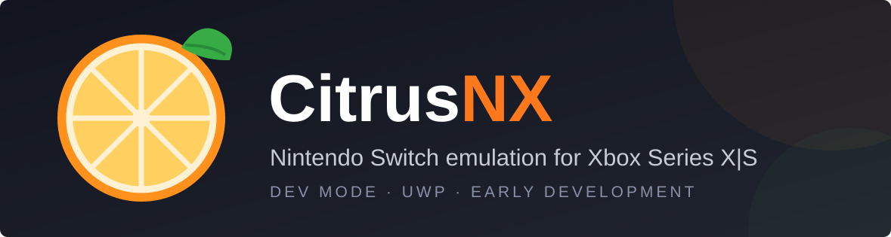

  

  
  
  

  <b>A Nintendo Switch emulator built for Xbox Dev Mode, tuned first for the Series S.</b>

---

## About

CitrusNX is a work-in-progress Switch emulator for Xbox Series X|S consoles running in Developer Mode. The goals:

- **Stability first**, especially on the Series S and its tight Dev Mode memory budget
- **Reliable firmware recognition** (developed against firmware 22.5.0)
- **A Switch-style home menu** with a polished, colorful interface
- **An easy install**: MSIX builds produced automatically by GitHub Actions

> **Heads up:** CitrusNX is in early development. Nothing here is a promise of game compatibility yet. Compatibility testing is left to the community.

## Roadmap

- [ ] Project scaffolding and UWP/MSIX packaging
- [ ] GitHub Actions: automatic MSIX builds
- [ ] Graphics backend (D3D12 path)
- [ ] CPU core / JIT in the Dev Mode sandbox
- [ ] Memory management tuned for the Dev Mode budget
- [ ] Firmware and key loading
- [ ] Controller input and Xbox-native navigation
- [ ] Home menu, themes and settings UI
- [ ] Per-game settings and shader/pipeline caching
- [ ] First homebrew boot, then first retail title

See [Issues](../../issues) for what is being worked on.

## Requirements

- Xbox Series X or Series S in **Developer Mode** (requires the Xbox Dev Mode app and a Partner Center developer account)
- Your own legally dumped firmware, keys and games from a Switch you own
- A way to sideload an MSIX (Xbox Device Portal)

CitrusNX does **not** include games, firmware or keys, and will never help you obtain them.

## Install

1. Download the latest `.msix` from [Releases](../../releases) (coming soon).
2. Open the Xbox Device Portal on your console's IP address.
3. Install the package through the portal, then launch CitrusNX from the console.

## Building

Automated builds via GitHub Actions are planned. Build instructions for local development will be added as the project structure settles.

## Contributing

Ideas, bug reports and pull requests are welcome. Please open an issue first for larger changes.

## Acknowledgements

CitrusNX stands on the shoulders of the open-source Switch emulation community. Credits and licenses for any incorporated code will be listed here as the codebase takes shape.

## License

License to be finalized. Any code derived from GPL-licensed projects must remain compatible with those licenses.

## Disclaimer

CitrusNX is an independent community project. It is not affiliated with, endorsed by, or sponsored by Nintendo or Microsoft. "Nintendo Switch" and "Xbox" are trademarks of their respective owners. Only use CitrusNX with games and firmware you legally own.
